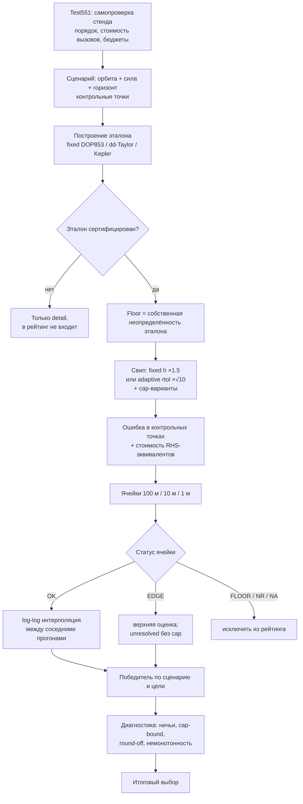
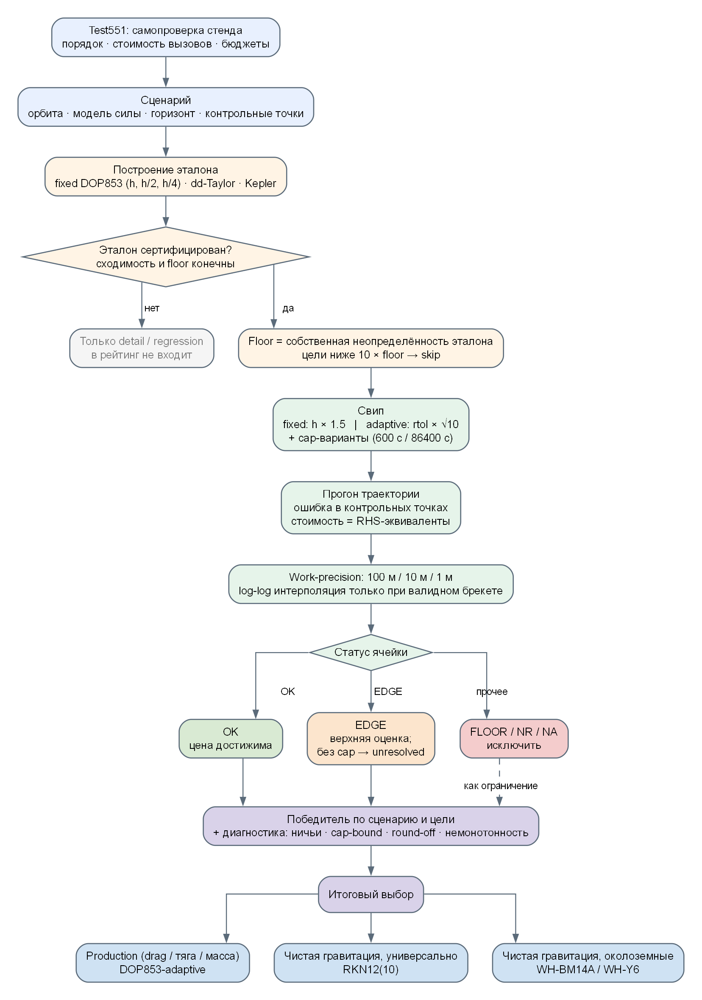

> **Числа до 2026-11-09 недействительны, см. REPORT_DATA_AUDIT.md.**

# Схема испытаний орбит и траекторий: сравнение интеграторов и выбор лучшего

Дата: 2026-11-08
Основание: Test551–559, текущее рабочее дерево (HEAD `826ac2b` + исправления harness; артефакты перегенерированы)
Первичные данные:

- `results/Test552_FrameworkShipSweep.md/.csv` — 17 сертифицированных сценариев корабля (включая Moon-centered SOI);
- `results/Test553_FrameworkPlanetSweep.md/.csv` — 6 сценариев планет;
- `results/Test554_FrameworkOrbitEdgeCases.md/.csv` — Луна/SOI, гипербола, 30 суток и 1000 витков на цели до 1 см;
- `results/Test555_LowAltitude.md/.csv` — ARCHIVED (парашют/взлёт/suicide/вход/лестница);
- `results/Test557_ProductionChunking.csv` — ARCHIVED (production-чанкинг);
- `results/Test558_J2AndSun.md/.csv` — развёртка J2 ×0/0.1/1/10 и наклонений 0/45/90/98, normalized Sun 1 AU, инварианты;
- `results/Test559_PureGravity.md/.csv`, `Test559_MoonFlybyMap.md`, `Test559_Transitions.md` — чистая гравитация: Луна/орбиты/прыжки/пролёты, гелиоцентрика, планеты, малое тело, far-flight;
- `results/Test_ALL_WorkPrecision.csv`, `Test_ALL_WorkPrecisionCrossovers.md` — work-precision кривые и точки смены победителя;
- `results/Test*_ModeSummary.md` — агрегация по тегам режимов;
- `results/Test551_FrameworkSelfTest.log` — самопроверка стенда;
- `results/Test549_SpacecraftOrbitIntegrators.log` — историческая матрица production-пути (не основа рейтинга).

---

## 0. Короткий ответ

| Задача | Лучший выбор | Почему |
|---|---|---|
| **Production: игра, все силы** (гравитация + J2 + атмосфера + тяга) | **DOP853-adaptive** (текущий default) | самый дешёвый из практичных валидных методов; 9/9 клеток drag/burn. Важно: `DOPRI5-adaptive`, `IAS15` и `Encke-IAS15` тоже валидны — DOP853 не единственный, а самый дешёвый/удобный |
| **Чистая гравитация, универсально** (корабли + планеты, без центрального тела) | **RKN12(10)** | 12/16 первых мест на планетах и 11/49 на кораблях; лучший или в пределах 1.1–1.6× от лучшего почти во всех околоземных сценариях |
| **Чистая гравитация, максимум скорости у Земли** | **WH-BM14A** (или WH-Y6) | 16/49 первых мест; LEO 1 м: 1 824 вызова против 9 769 у *настроенного на 1 м* DOP853 (~5.4×). Это **14 стадий, 6-й порядок** (Blanes–Moan SRKN14A), а не 14-й порядок. Текущий production-default DOP853 на том же LEO стоит ~61 854 вызова (см. §8.1) |
| **Планеты / N-body** | **RKN12(10)** | 12/16 первых мест, 14/16 «победитель или ничья»; GJ8 — второй, но его наблюдаемый порядок в реальных сценариях 8.2–8.9 вместо 10 |
| **Drag / тяга / переменная масса** | **DOP853-adaptive** | symplectic/Kepler-split/RKN-методы помечены `n/a`: порядок расщепления теряется. DOPRI5/IAS15/Encke тоже проходят эти силы, но дороже или менее удобны |
| **Луна/SOI, гипербола, длинный warp** | **Test554:** Moon-centered SOI — adaptive/WH-Y6 вничью на 1 м; гипербола на 1 см — RKN12(10) 1 291; 1000 витков на 1 м — WH-Y6 100 355 ~ WH-BM14A 102 144 | см. §7.4; на 1 м гипербола всё ещё `EDGE`, поэтому для неё нужна цель 0.1/0.01 м, а не 1 м |

Главный вывод: **одного «лучшего вообще» нет**. Есть лучший production-метод (DOP853) и лучший метод для чистой орбитальной механики (RKN12(10), с WH-BM14A/WH-Y6 как более быстрыми околоземными вариантами). Но WH-BM14A/SRKN14A — 6-го порядка, а на Луне/гиперболе картина меняется: там выигрывают adaptive RK или RKN12.

---

## 1. Цель и границы

Проверяются два разных вопроса:

1. **Production-вопрос.** Какой интегратор должен считать траекторию корабля в игре, где сила зависит от времени, положения, скорости и массы (атмосфера, тяга, переменная масса), а также возможны сближения с Луной и планетами?
2. **Орбитальный вопрос.** Какой метод точнее и дешевле на чистой гравитационной задаче: кеплеровские орбиты, J2, N-body планет?

Что **не** является целью:

- микро-бенчмарк одного шага (измеряется вся траектория до горизонта);
- сравнение по `wall-clock` как основной метрике (таймер шумит; основной рейтинг — детерминированная стоимость);
- подгонка tolerance-гейтов под текущие числа (гейты калибруются отдельно, см. `ToleranceTable`).

---

## 2. Общая схема испытания



Та же схема в виде изображения (исходник — `orbit_integrator_test_scheme.dot`, рядом лежат `.svg` и `.png`):



Текстом:

1. **Test551** проверяет сам стенд: порядок каждого fixed-метода, точную формулу числа RHS-вызовов, бюджеты, слияние стоп-точек, advanced-порты. Если Test551 падает, результатам свипа доверять нельзя.
2. **Сценарий** задаёт начальное состояние, модель силы, горизонт и контрольные точки.
3. **Эталон** строится независимо от кандидатов и сертифицируется по собственному сходимости-ряду.
4. **Свип** прогоняет каждый метод по сетке управляющего параметра: `h` для fixed-step, `rtol` для adaptive. Adaptive дополнительно прогоняется с production-cap (600 с для корабля, 86400 с для планет).
5. **Ошибка** считается в контрольных точках (у корабля — примерно одна точка на виток, от 8 до 256, плюс края импульсов; у планет — сэмплы каждые 30 суток): для корабля — по положению, для планет — по максимальной относительной ошибке пары тел.
6. **Ячейка work-precision** отвечает на вопрос: сколько RHS-эквивалентных вызовов нужно, чтобы достичь 100/10/1 м.
7. **Рейтинг** сравнивает стоимость ячеек; ничьи, cap-bound и round-off помечаются явно.

---

## 3. Что именно измеряется

### 3.1. Состояние и сила

Корабль: `y = [r(3), v(3), m(1)]`, `Dim = 7`, `PosDim = 3`.

$$ \dot r = v,\qquad \dot v = a(t, r, v, m),\qquad \dot m = -\frac{T}{I_{sp}\,g_0}\ \text{(при работающем двигателе)}. $$

Модели силы:

- чистая гравитация (baked N-body эфемерида + центральное тело);
- J2;
- атмосфера (drag зависит от скорости);
- тяга (зависит от времени, массы, направления);
- их комбинации.

Планеты: `y = [r_1..r_n, v_1..v_n]`, чистая взаимная гравитация.

### 3.2. Ошибка

Для корабля в каждой контрольной точке `t_k`:

$$ e_k = \lVert r_k - r_k^{ref} \rVert_2,\qquad E = \max_k e_k. $$

Дополнительно пишутся `E_final`, `dv_max`, `da`, `de`, `dE/E`, но **рейтинг идёт по `E`** — максимальной ошибке положения за весь горизонт, а не только в конце.

Для планет:

$$ E = \max_k \max_{i<j} \lVert (r_i-r_j)_k - (r_i-r_j)_k^{ref} \rVert. $$

Относительная ошибка пары, а не барицентрическая позиция: иначе Луна «теряется» на фоне 1 а.е.

### 3.3. Стоимость

Основная метрика — **RHS-эквивалентные вызовы**:

$$ C = N_{RHS}\cdot m_{RHS} + w_K N_{Kepler}. $$

- `m_RHS = 3` для production-local пути корабля (три поля гравитации), `1` для стендового;
- `w_K = 1` — одно решение универсального Кеплера стоит одного RHS-вызова;
- `ms` — вторичная метрика, шумит на суб-миллисекундных значениях.

### 3.4. Эталон и floor

- **Корабль:** fixed DOP853 с шагом, уменьшаемым в 2 раза; floor = разница двух самых точных прогонов (плюс независимый dd/Y6C и dd-Taylor cross-check, где он есть). Для Moon-centered SOI reference step задан явно (`h0=40 000 с`), потому что слишком мелкий шаг уходит в round-off; для 1000 витков Test554 использует локальный floor `1.82e-4 м`, а DD-endpoint `8.52 м` печатает как диагностику формулировки.
- **Планеты:** dd-Taylor K-порядка с шагами 43200 с и 21600 с; floor = худшая разница между ними по парам.
- **Кеплеровские сценарии:** замкнутое аналитическое решение (не интегратор).

Сертификация: floor должен быть конечным и меньше цели. Если эталон не сошёлся (`ratio` не соответствует порядку), сценарий помечается `NOT CERTIFIED` и **не попадает в сводку**.

### 3.5. Шум округления

Для каждого прогона:

$$ \varepsilon_{round} = 16\,\varepsilon_{machine}\, L\, \sqrt{N_{steps}}, $$

где `L = ScaleLength`. Если ошибка прогона или цель ниже этого шума, ячейка получает `below round-off floor` и не участвует в рейтинге: это измерение суммирования, а не точности метода.

### 3.6. Цели

Единый набор абсолютных целей Test552: **100 м, 10 м, 1 м** — для всех сценариев корабля, чтобы столбцы сводной таблицы означали одно и то же. Test554 добавляет **0.1 м и 0.01 м** для Луны, гиперболы и длинных дуг: на 1 м фиксированные методы там часто уже ниже цели в самой дешёвой точке. Для планет — те же 100/10/1 м по худшей паре.

Цель ниже `10 × floor` пропускается (`skip`).

---

## 4. Матрица сценариев

### 4.1. Корабль (17 сценариев, 1 сутки — 1 год)

| # | Сценарий | Орбита / силы | Горизонт | Эталон | Floor, м |
|---|---|---|---|---|---|
| 1 | Earth LEO 400 km circular | 6771 км, e=0, i=0, гравитация | 1 сут | fixed DOP853 | 5.02e-6 |
| 2 | Earth LEO 400 km polar | 6771 км, i=90° | 1 сут | fixed DOP853 | 1.46e-6 |
| 3 | Earth LEO 400 km sun-synchronous | 6771 км, i=98°, J2 | 1 сут | fixed DOP853 | 2.62e-6 |
| 4 | Earth GTO 400 × 40000 km | 6771 × 46371 км, i=28.5° | 2 сут | fixed DOP853 | 3.39e-6 |
| 5 | Earth Molniya 500 × 40000 km | i=63.4°, ω=270° | 7 сут | fixed DOP853 | 9.52e-5 |
| 6 | Earth GEO 35786 km | 42164 км, e≈0 | 30 сут | fixed DOP853 | 1.80e-4 |
| 7 | Sun 1 AU circular | 1 а.е., гравитация Солнца | 1 год | fixed DOP853 | 5.31e-4 |
| 8 | Sun 0.5 × 2 AU eccentric | 0.5 × 2 а.е. | 1 год | fixed DOP853 | 9.18e-4 |
| 9 | Earth 400 km + J2 | J2 без атмосферы | 1 сут | fixed DOP853 | 2.57e-6 |
| 10 | Earth 250 km + atmosphere drag | drag без J2 | 1 сут | fixed DOP853 | 1.92e-5 |
| 11 | LEO 400 km + 600 s prograde burn | 2000 Н, Isp 300, ramp 20 с | 1 сут | fixed DOP853 | 1.78e-5 |
| 12 | Earth–Moon flyby inside lunar SOI (Moon-centered) | сближение с Луной; Moon-centered local frame | 2 сут | fixed DOP853, h0=40 000 с | 4.62e-6 |
| 13 | LEO 400 km, 1000 orbits (~64 d) | длинная LEO | ~64 сут | DOP853 + dd endpoint (Test552); local floor (Test554) | 8.52 (formulation) / 1.82e-4 (local) |
| 14 | Earth HEO 300 × 120000 km | высокий эксцентриситет | 5 сут | fixed DOP853 | 2.32e-5 |
| 15 | Earth hyperbolic flyby e=1.5 | гипербола | 1 сут | fixed DOP853 | 1.82e-6 |
| 16 | LEO 400 km, 30 d | длинная LEO | 30 сут | fixed DOP853 | 2.54e-3 |
| 17 | LEO 400 km + unaligned 600 s burn | тяга под углом, ramp 1 с | 1 сут | fixed DOP853 | 2.51e-5 |

Сценарий 12 переделан: старый Earth-centered вариант не сходился (ratio 4.81, order 2.27), потому что внутри SOI доминирует Луна, а не Земля. Теперь пролёт интегрируется и сертифицируется в Moon-centered frame — той же системе, которую production выбирает через `FindDominantBody` внутри лунного SOI. Floor 4.62e-6 м, все 17 сценариев Test552 сертифицированы.

Для длинных дуг и гиперболы есть отдельный `Test554` (см. §7.4): он добавляет цели 0.1 м и 0.01 м, поэтому 1-см гипербола и цели 1 м/10 см на 1000 витках становятся разрешимыми, а не `EDGE unresolved`. Для 1000 витков Test554 использует локальный эталон (floor 1.82e-4 м), а расхождение с независимым DD-endpoint 8.52 м печатает как диагностику формулировки, не складывая его в floor.

### 4.2. Планеты (6 сценариев)

| # | Сценарий | Горизонт | Эталон | Floor, м |
|---|---|---|---|---|
| 1 | Real solar 7-body | 10 лет | dd-Taylor (43200/21600 с) | 5.88e-2 |
| 2 | Real solar 7-body | 100 лет | dd-Taylor | 1.71 |
| 3 | Custom 6-body | 10 лет | dd-Taylor | 3.59e-2 |
| 4 | Tight binary | 10 лет | dd-Taylor | 9.13e-2 |
| 5 | Sun + eccentric comet + Jupiter | 10 лет | dd-Taylor | 7.36e-2 |
| 6 | Heliocentric Sun–Jupiter probe | 10 лет | dd-Taylor | 6.88e-4 |

---

## 5. Каталог интеграторов

| Метод | Семейство | Порядок | Шаг | Валиден для | Комментарий |
|---|---|---|---|---|---|
| RK4 | Runge–Kutta | 4 | fixed | любых сил | базовая линия |
| DOPRI5-fixed | Runge–Kutta | 5 | fixed | любых сил | дешёвый fixed RK |
| DOPRI5-adaptive | Runge–Kutta | 5 | adaptive | любых сил | контроль ошибки |
| DOP853-adaptive | Runge–Kutta | 8 | adaptive | любых сил | **production default** |
| PEFRL | Symplectic | 4 | fixed | консервативных |
| Y6 | Symplectic (Yoshida) | 6 | fixed | консервативных |
| Y6C | Symplectic + compensated | 6 | fixed | консервативных | лучше на длинных дугах |
| WH-Y6 | Kepler-split (Wisdom–Holman) | 6 | fixed | консервативных + центральное тело | точный кеплеровский дрейф |
| Leapfrog | Symplectic | 2 | fixed | консервативных | базовая линия |
| RKN12(10) | Runge–Kutta–Nyström | 12(10) | adaptive | консервативных | **лучший универсальный по чистой гравитации** |
| IAS15 | Gauss–Radau | высокий | adaptive | вторых производных, включая drag/thrust | дорогой, но устойчивый |
| SRKN14A | Symplectic RKN | **14 стадий, 6-й порядок** | fixed | консервативных | Blanes–Moan SRKN14A; «14» — число стадий, не порядок |
| WH-BM14A | Kepler-split | **14 стадий, 6-й порядок** | fixed | консервативных + центральное тело | **самый дешёвый в LEO (в ничьей с WH-Y6)**; это SRKN14A-композиция, не 14-й порядок |
| GJ8 | Gauss–Jackson | **10 (разностный 8)** | fixed | консервативных | multistep, нужен старт; в реальных сценариях наблюдаемый порядок 8.2–8.9 |
| Encke-IAS15 | Encke + IAS15 | высокий | fixed | центральное тело + произвольные возмущения, включая drag/thrust | на чистом Кеплере уходит ниже floor |

Правила валидности:

- symplectic, Kepler-split и RKN-методы **не поддерживают** силу, зависящую от скорости или массы (drag/thrust): помечаются `n/a`;
- `IAS15` и `Encke-IAS15` — исключения: они валидны для drag/thrust (Encke требует центральное тело, IAS15 — нет);
- WH-Y6, WH-BM14A, Encke-IAS15 требуют центральное тело в начале координат;
- RKN12(10), SRKN14A, GJ8 требуют консервативную вторую производную;
- adaptive-методы дополнительно прогоняются с cap (600 с / 86400 с), потому что cap — это конфигурация, а не метод.

`RKN12(10)`, `IAS15`, `SRKN14A`, `WH-BM14A`, `GJ8` и `Encke-IAS15` — advanced-порты стенда (`Study/framework`); в production-коде игры их пока нет. Их результаты — это оценка потенциала, а не описание текущего production-пути.

Важно про порядки: `WH-BM14A` и `SRKN14A` — **6-го порядка** (14 стадий), `WH-Y6` — 6-го, `RKN12(10)` — 12-го. Поэтому «WH-BM14A быстрее» — эмпирический результат на цели 1 м, а не следствие более высокого порядка. На более жёстких целях (1 см) преимущество может уйти к RKN12(10)/DOP853; см. Test554.

---

## 6. Алгоритм рейтинга

### 6.1. Построение ячейки

Для каждого метода и цели `T`:

1. Отсортировать успешные точки по стоимости.
2. Найти первую точку с `Err <= T`, у которой `Err` выше собственного round-off floor.
3. Если это самая дешёвая точка — `EDGE`: верхняя оценка. Если она cap-limited, цена точная; иначе `unresolved`.
4. Иначе попытаться интерполировать `log T` между последней точкой выше цели и первой ниже:

$$ \log C(T) = \log C_{miss} + \frac{\log T - \log E_{miss}}{\log E_{hit} - \log E_{miss}}\,(\log C_{hit} - \log C_{miss}). $$

5. Интерполяция разрешена только если:
   - стоимость точек отличается не более чем в 1.5×;
   - локальный порядок попадает в ±30% от заявленного;
   - метод adaptive или fixed с объявленным порядком.
6. Иначе — первая реально прошедшая точка, без экстраполяции.

### 6.2. Ничьи

- adaptive-ячейки: `~`, если стоимость в пределах 10% от победителя;
- fixed-step без интерполяции: полоса ничьей равна одному шагу сетки;
- ничья между методом и его cap-вариантом не считается: это одна и та же конфигурация;
- cap-вариант называется отдельно только если он реально решает результат.

### 6.3. Что исключается

| Статус | Значение |
|---|---|
| `OK` | стоимость достижима, участвует в рейтинге |
| `EDGE` | даже самый дешёвый прогон уже ниже цели; цена — верхняя оценка |
| `FLOOR` | цель/ошибка ниже шума округления |
| `NR` | цель не достигнута |
| `SKIP` | цель ниже `10 × floor` |
| `NA` | метод не применим к данной силе |

---

## 7. Результаты

### 7.1. Победители на цели 1 м (корабль)

| Сценарий | Победитель (RHS-экв.) | Статус |
|---|---|---|
| LEO 400 km circular | WH-Y6 1 795 ~ WH-BM14A 1 824 | ничья 56% |
| LEO 400 km polar | WH-Y6 1 795 ~ WH-BM14A 1 824 | ничья 56% |
| LEO 400 km sun-synchronous | RKN12(10) 4 236* ~ WH-BM14A 4 560 | ничья 10% |
| GTO 400 × 40000 km | WH-Y6 5 211 ~ RKN12(10) 5 227* ~ WH-BM14A 5 301 | ничья 46% |
| Molniya 500 × 40000 km | WH-BM14A 18 297 ~ RKN12(10) 19 259* ~ WH-Y6 26 967 | ничья 56% |
| GEO 35786 km | WH-BM14A 6 840 | — |
| Sun 1 AU circular | RKN12(10) 678* | — |
| Sun 0.5 × 2 AU eccentric | RKN12(10) 1 060* | — |
| Earth 400 km + J2 | WH-BM14A 1 824 | — |
| Earth 250 km + atmosphere drag | DOP853-adaptive 10 063* | — |
| LEO + 600 s prograde burn | DOP853-adaptive 10 529* | — |
| Moon SOI flyby (Moon-centered) | WH-Y6 507 ~ DOPRI5-adaptive 521* ~ DOP853-adaptive 562* ~ SRKN14A 756 | 1 м — EDGE unresolved (507 — верхняя оценка); 10 м разрешено |
| LEO 1000 orbits (~64 d) | WH-BM14A 72 960 (цель 100 м); Test554: WH-Y6 100 355 ~ WH-BM14A 102 144 на 1 м | Test552: только 100 м; Test554: локальный floor, 1 м разрешён |
| HEO 300 × 120000 km | RKN12(10) 6 626* ~ DOP853-adaptive 8 736* | ничья 56% |
| Hyperbolic flyby e=1.5 | 1 м: WH-BM14A <= 912 EDGE — **unresolved**; 0.1 м: RKN12(10) 1 227* ~ ...; 0.01 м: RKN12(10) 1 291* | на 1 м не решается; на 1 см — RKN12 |
| LEO 400 km, 30 d | WH-Y6 57 347 ~ WH-BM14A 58 368 | ничья 18%; Test554 0.1 м: WH-BM14A 58 368 |
| LEO + unaligned 600 s burn | DOP853-adaptive 11 067* | — |

`*` — интерполированная стоимость. `~` — ничья, рейтинг не разрешён.

**Проценты в «ничьей» — это разрешение сетки, а не разница стоимостей.** Например, LEO 1 м: `WH-Y6 1 795` и `WH-BM14A 1 824` отличаются на 1.6%, но клетка без парных точек имеет полосу ничьей в один шаг сетки 1.5× = 56%. Не читай «56%» как «методы отличаются на 56%».

### 7.2. Победители на цели 1 м (планеты)

| Сценарий | Победитель | Статус |
|---|---|---|
| Real solar 7-body, 10 y | RKN12(10) 29 096* | — |
| Real solar 7-body, 100 y | GJ8 285 002* ~ RKN12(10) 288 995* (цель 100 м) | ничья 10% |
| Custom 6-body, 10 y | RKN12(10) 50 324* ~ GJ8 54 934* | ничья 10% |
| Tight binary, 10 y | RKN12(10) [cap] <= 62 153 EDGE | cap-limited |
| Sun + comet + Jupiter, 10 y | RKN12(10) 9 489* | — |
| Sun–Jupiter probe, 10 y | RKN12(10) 4 529* ~ WH-BM14A 7 018 ~ GJ8 8 602* | ничья 100% |

### 7.3. Сводный счёт

По 49 ранжируемым клеткам корабля (17 сертифицированных сценариев × 3 цели, минус 2 недостигнутые цели у 1000 orbits; Moon-centered flyby теперь сертифицирован и входит в сводку):

| Метод | Первая строка клетки | «Победитель или ничья» |
|---|---|---|
| WH-BM14A | 16 | 27 |
| WH-Y6 | 12 | 17 |
| RKN12(10) | 11 | 16 |
| DOP853-adaptive | 9 | 13 |
| DOPRI5-adaptive | 1 | 4 |
| DOPRI5-fixed | 0 | 1 |
| SRKN14A | 0 | 1 |

«Первая строка» — метод, перечисленный в клетке первым; при ничьей клетка засчитывается всем участникам в соседнем столбце, поэтому сумма «победитель или ничья» больше 49. Многие клетки — `~`/`EDGE unresolved`; для решения смотри не эту таблицу, а подробный Test552 и Test554.

По 16 ранжируемым клеткам планет (6 сценариев × 3 цели, минус 2 пропуска у 100-летнего горизонта):

| Метод | Первых мест | «Победитель или ничья» |
|---|---|---|
| RKN12(10) | 12 | 14 |
| GJ8 | 4 | 8 |

Сумма «победитель или ничья» может превышать число клеток: при ничьей клетка засчитывается всем участникам.

Интерпретация:

- **WH-BM14A** — самый частый «первый» на кораблях, но только в чистой гравитации с центральным телом и с большим числом ничьих. На 30-суточном LEO и 1000 орбитах он устойчив; на 1000 орбитах (Test554, локальный floor) на 1 м он в ничьей с WH-Y6, а на 1 см уступает WH-Y6.
- **RKN12(10)** — самый универсальный: побеждает на Солнце и планетах, где WH-методы не применимы, и на 1-см гиперболе (Test554, 1 291). В большинстве околоземных сценариев он в 1.0–1.6× от лучшего.
- **DOP853** — самый дешёвый из практичных валидных в drag/thrust; `DOPRI5-adaptive`, `IAS15` и `Encke-IAS15` тоже валидны, но дороже/менее удобны. Его 9 клеток — это не конкурентная победа над symplectic, а их `n/a`.
- **GJ8** — сильный второй на планетах, но требует старта и fixed-step; наблюдаемый порядок в реальных сценариях 8.2–8.9 вместо 10. RKN12(10) удобнее и в среднем дешевле.
- **Moon-centered SOI (Test554)** — на 1 м adaptive/WH-Y6 идут вничью; на 1 см DOP853-adaptive 579* (EDGE unresolved) — то есть «WH всегда лучший» для Луны неверно.
- **Гипербола (Test554)** — на 1 м клетка `EDGE unresolved`; на 0.1 м RKN12(10) 1 227* ~ DOP853 1 288* ~ WH-BM14A 1 824; на 1 см RKN12(10) 1 291*. Для гиперболы нужен RKN12, а не WH.

---

### 7.4. Test554: Луна/SOI, гипербола, длинный warp

`Test554` добавляет к общему свипу цели **0.1 м и 0.01 м** и отдельно измеряет production-local DOP853 при 600-секундных чанках. Это нужно, потому что на 100/10/1 м фиксированные методы на Луне и гиперболе часто уже ниже цели в самой дешёвой точке (`EDGE`), и 1-м клетка ничего не говорит о стоимости.

| Сценарий | 100 м | 10 м | 1 м | 0.1 м | 0.01 м |
|---|---|---|---|---|---|
| Moon-centered SOI flyby | WH-Y6 <=255 EDGE | DOPRI5-adaptive 387* ~ DOPRI5-fixed 560* ~ WH-Y6 507 | WH-Y6 507 ~ DOPRI5-adaptive 521* ~ DOP853-adaptive 562* ~ SRKN14A 756 (unresolved) | WH-BM14A <=513 EDGE | DOP853-adaptive 579* (unresolved) |
| 1000 orbits (~64 d), local floor | WH-BM14A 72 960 | WH-Y6 100 355 ~ WH-BM14A 102 144 | WH-Y6 100 355 ~ WH-BM14A 102 144 | WH-BM14A 131 328 | WH-Y6 960 515 |
| Hyperbolic flyby e=1.5 | WH-Y6 <=451 EDGE | WH-Y6 899 ~ DOPRI5-adaptive 1 004* ~ DOP853-adaptive 1 014* | WH-BM14A <=912 EDGE (unresolved) | RKN12(10) 1 227* ~ DOPRI5-adaptive 1 890* ~ DOP853-adaptive 1 288* ~ WH-BM14A 1 824 | RKN12(10) 1 291* |
| LEO 400 km, 30 d | WH-BM14A 29 184 ~ WH-Y6 43 011 | WH-BM14A 43 776 ~ WH-Y6 50 179 | WH-Y6 57 347 ~ WH-BM14A 58 368 | WH-BM14A 58 368 | — |

Production-local DOP853, 600-секундные чанки, текущие допуски (`Test554_Production.csv`):

| Сценарий | raw calls | RHS-экв. | max err, м | ms |
|---|---|---|---|---|
| Moon-centered SOI flyby | 3 770 | 11 310 | 2.95e-4 | 8.0 |
| 30 d LEO | 619 290 | 1 857 870 | 1.30e-3 | 483 |
| 1000 orbits | 1 321 242 | 3 963 726 | 1.20e-2 | 1 412 |
| Hyperbolic flyby e=1.5 | 2 989 | 8 967 | 1.74e-6 | 2.1 |

Выводы:

- **Луна/SOI**: на 1 м adaptive RK и WH-Y6 идут вничью; на 1 см DOP853-adaptive 579* — то есть «WH всегда лучший» для Луны неверно. Production-path DOP853 даёт 2.95e-4 м за 11 310 RHS-экв. (600-с чанки), что в ~20× дороже harness-строки из-за чанкинга/допусков.
- **Гипербола**: на 1 м клетка `EDGE unresolved`; на 0.1 м RKN12(10) 1 227* ~ DOP853 1 288* ~ WH-BM14A 1 824; на 1 см RKN12(10) 1 291*. Production DOP853 при 600-с чанках даёт 1.74e-6 м за 8 967 RHS-экв. — очень дёшево для одного пролёта; для гиперболы выбирать WH нельзя, нужен RKN12.
- **1000 витков**: с локальным floor 1.82e-4 м цель 1 м разрешается: WH-Y6 100 355 ~ WH-BM14A 102 144; 0.1 м — WH-BM14A 131 328; 0.01 м — WH-Y6 960 515. Независимый DD-endpoint отличается на **8.52 м** — это разница формулировок (world-frame DD vs game local frame), она печатается в reference note и не складывается в floor. Для game local path это корректно; для утверждения «1 м в абсолютном world frame» — нет.
- **30 суток**: 1 м — WH-Y6 57 347 ~ WH-BM14A 58 368; 0.1 м — WH-BM14A 58 368. **Сравнение при равной точности:** harness DOP853 на 1 м — 659 541, то есть WH дешевле в ~11.3×, а не в 32×. Production DOP853 при 600-с чанках стоит 1 857 870 RHS-экв. и даёт 1.3e-3 м — он точнее цели на три порядка, поэтому 32× против него — сравнение на разных уровнях точности.

---

### 7.5. Карта режимов (сгенерирована одним кодом из CSV)

Таблица ниже собрана механически из `Test559_FinalMap.md`, `Test552_FinalMap.md` и `Test558_FinalMap.md`; все три файла пишет `StudyRegimeAnalysis` из соответствующего sweep-CSV. Ручных чисел нет. Классы: `decisive` (margin > 2), `marginal` (1.5–2), `equivalent` (< 1.5), `floor-limited` (в самой дешёвой точке сетки цель уже достигнута; не `equivalent`), `trivial` (цена < 200 RHS), `uncertified-reference` (эталон того же семейства; не `decisive`). Для `equivalent`-множеств цена интерполирована; для `floor-limited` показана самая дешёвая точка.

| mode | scenarios | cells | decisive winner / equivalent set | failed-validity | floor-limited | uncertified-ref | trivial | N | W | median margin | bad share | confidence |
|---|---|---|---|---|---|---|---|---|---|---|---|---|
|far-flight|1|6|-|-|3|0|0|1|0|-|1.00|low|
|far-normalized|1|6|-|-|4|0|0|1|0|-|1.00|low|
|heliocentric-orbit|16|96|RKN12(10) (2)|-|23|18|1|16|2|1.69|0.62|low|
|moon-flyby|24|144|eq: DOP853-adaptive, RKN12(10), DOPRI5-adaptive|-|22|3|6|24|0|1.16|0.19|low|
|moon-hop|8|42|-|-|38|0|4|7|0|-|1.00|low|
|moon-orbit|7|42|eq: WH-BM14A, RKN12(10), GJ8, WH-Y6|-|24|0|0|7|0|1.07|0.62|low|
|planet-flyby|6|36|eq: RKN12(10), DOP853-adaptive, DOPRI5-adaptive|-|9|5|0|6|0|1.20|0.25|low|
|small-body-flyby|3|18|-|-|12|0|6|3|0|-|1.00|low|
|drag|1|3|eq: DOP853-adaptive, IAS15|-|0|1|0|1|0|1.39|0.00|low|
|eccentric|3|9|eq: RKN12(10), WH-BM14A, WH-Y6, DOP853-adaptive|-|2|0|0|3|0|1.23|0.22|low|
|flyby|2|6|-|-|6|0|0|2|0|-|1.00|low|
|heliocentric|1|3|eq: RKN12(10)|-|2|1|0|1|0|2.65|0.67|low|
|heliocentric-eccentric|1|3|eq: RKN12(10)|-|0|3|0|1|0|1.74|0.00|low|
|j2|2|6|WH-BM14A (1)|-|1|0|0|2|1|1.08|0.17|medium|
|pure-circular|3|9|eq: WH-BM14A, WH-Y6, GJ8, RKN12(10)|-|2|0|0|3|0|1.31|0.22|low|
|pure-circular-long|2|6|eq: WH-BM14A, WH-Y6|-|0|0|0|2|0|1.21|0.33|low|
|thrust|2|6|eq: DOP853-adaptive, DOPRI5-adaptive, IAS15|-|0|2|0|2|0|1.46|0.00|low|
|j2-sensitivity|16|80|WH-BM14A (3)|-|6|2|0|16|3|1.23|0.07|medium|
|sun-normalized|1|5|-|-|5|0|0|1|0|-|1.00|low|

Правило уверенности: `high` = N>=3, W>=3, медианный margin > 1.5, доля (trivial+floor-limited+unresolved+no-winner)/cells < 0.25; `medium` = N>=2, W>=1, медианный margin > 1.0, доля < 0.60; иначе `low`; `none` — нет сертифицированных клеток. `N` — независимые сценарии без `near-uniform-field` и архивных; `W` — только `decisive`-клетки. Все чистогравитационные режимы в этом прогоне получили `low`: либо нет decisive-клеток, либо велика доля floor-limited/trivial/no-winner.

**Что данные не различают.** Лунные пролёты на 100 км: DOP853, RKN12 и DOPRI5 эквивалентны по цене на 1 м и 0.01 м (margins 1.05–1.19); при v∞=10000 м/с на 1 м DOPRI5 и DOP853 неразличимы (1.46), а RKN12/WH-BM14A/IAS15 уже достигли цели в самой дешёвой точке (floor-limited). Планетный пролёт 3 R: DOP853 и RKN12 эквивалентны (1.03–1.38). Лунная орбита: WH-BM14A/RKN12/GJ8/WH-Y6 эквивалентны, а на одном витке клетка floor-limited. Лунные прыжки: только trivial/floor-limited, цена отражает число шагов, а не порядок точности. В drag/thrust DOP853 и IAS15 эквивалентны по цене (margin ~1.18–1.46); DOP853 предпочтителен по причинам вне цены — он интегрирован в игру и является production-путём. На 5/30 а.е. при 1 м клетки либо floor-limited (DOP853/RKN12 в самой дешёвой точке уже ниже цели), либо trivial (DOPRI5, 6 стадий, цена < 200); при 0.01 м независимый эталон IAS15 имеет floor 0.011–0.072 м, поэтому клетки uncertified и исключены из decisive.

**Failed-validity.** После исправления `KeplerUniversal` (переход к бисекции при нулевом знаменателе Лагерра) ни один прогон не оборвался на Kepler drift; `WH invalid` в карте больше нет. Отрицательные `h` в сообщениях WH-BM14A — это отрицательные подшаги композиции BM14A, а не отрицательный внешний шаг.

**Что не покрыто.** Независимый эталон IAS15 построен только для указанных клеток (лунные пролёты v∞ 200/1000/10000 при 100 км, лунная орбита 100 км ×1, гелиоцентрика 1 а.е. e=0.9, 5/30 а.е. e=0/0.5). Остальные клетки по-прежнему имеют эталон fixed DOP853; их `decisive` не считается. Для 1 а.е. e=0.9 и 5/30 а.е. цель 0.01 м не сертифицирована (floor 0.0196/0.011/0.027/0.045/0.072 м). Тай-прогон 1.15 использовал 5 методов, а не все 15; отсутствие WH-Y6 в этих клетках не проверено. Дрейф момента импульса для J2 не приводится: J2 его не сохраняет.
### 7.6. Test555 — ARCHIVED

`Test555` (парашют, вертикальный взлёт, suicide burn, вход в атмосферу, высотная лестница) **исключён из карты режимов и счёта побед**. Код и отчёт сохранены для истории; все `StudyProblem` помечены `Archived=true`, `StudyModeSummary` их пропускает. Уточнение задачи: «полёт у поверхности» означает чистогравитационный полёт, а не посадку/атмосферу.

### 7.7. Test557 — ARCHIVED

`Test557` (production-чанкинг) больше не развивается. Код и `Test557_ProductionChunking.csv` оставлены как исторический результат; в карту и счёт побед не входят.

### 7.8. Test558: J2/наклонение, normalized Sun, инварианты

- **J2 ×0 / 0.1:** WH-Y6/WH-BM14A; при ×0.1 на 1 м WH-BM14A, на 0.01 м уже RKN12 при inc 45/90/98.
- **J2 ×1:** inc 0 — WH-BM14A; inc 45/90/98 — RKN12 (на 1 м 4 236* против 4 560 у WH-BM14A). Это граница, где Kepler-split перестаёт быть лучшим.
- **J2 ×10:** RKN12 практически везде, включая 0.01 м; GJ8 иногда третий.
- **Sun 1 AU normalized:** Encke-IAS15 — точный Kepler-дреф и даёт только `EDGE` (64); resolved-победителя нет. WH-BM14A/Encke больше не `FLOOR`, но на чистом Кеплере их преимущество не измерить.
- **Инварианты:** `Test558_Invariants.csv` содержит `energy_drift`; для J2 используется потенциал J2 `U = -mu/r (1 - J2 (R/r)^2 (3/2 (z/r)^2 - 1/2))`. `angular_drift` для J2 не считается (J2 не сохраняет момент). Для LEO с Луной это всё ещё двухтельная/J2-диагностика, а не полный N-body интеграл.

### 7.9. Test559: чистая гравитация без тяги и атмосферы

`Test559` — 60 сценариев, все 15 интеграторов, цели 100/10/1/0.1/0.01 м. Все сценарии содержат реальное возмущение: Луна — Земля (третье тело), гелиоцентрика — Юпитер, пролёт планеты — Солнце, малое тело — Солнце. Чистого Кеплера в наборе нет, поэтому Encke не получает тривиального преимущества.

**Луна, орбиты 1/10/100/1000 км:** на 1 м одна орбита даёт `EDGE`; добавлены длинные варианты 100 км ×10/100/1000 витков. На 10 и 100 витках 1 м — ties/equivalence; на 1000 витках 1 м — WH-BM14A `103 936` (RKN12/GJ8 в equivalent-полосе). 0.001 м на 1000 витках `skip` (floor 5.86e-3 м). Земля задана **baked-эфемеридой** `StudyRealSolar7` (Chebyshev, не круговая и не аналитическая); эталон — fixed DOP853, 5 уровней.

**Луна, прыжки 50–1600 м/с:** Δg/g: 50 м/с — `0.000888` (near-uniform, исключён из победителей), 200 — `0.0141`, 500 — `0.083`, 1000 — `0.279`, 1200–1600 — `0.37–0.53`. Гипотеза «Leapfrog только из-за однородного поля» подтверждается для 50 м/с, но **не** для 200/500: там Leapfrog всё ещё впереди в грубом анализе, однако в `StudyReport` это `EDGE/unresolved`, а не decisive. На 1000–1600 м/с — equivalent-наборы DOPRI5-fixed/RK4/PEFRL/Y6; стабильного победителя нет. Добавлены 1200/1400/1600 м/с с земным возмущением.

**Луна, пролёты — 2D-карта `v∞ × перицентр`:**
1 м:

| v∞ \ alt км | 1 | 10 | 100 | 1000 |
|---|---|---|---|---|
| 50 | DOP853 ~ | DOP853 ~ | DOP853 ~ | DOP853 ~ |
| 200 | DOP853 ~ | DOP853 ~ | DOP853 ~ | DOP853 ~ |
| 500 | DOP853 ~ | DOP853 ~ | DOP853 ~ | DOP853 ~ |
| 1000 | DOP853 ~ | DOP853 ~ | DOP853 ~ | DOP853 ~ |
| 3000 | DOPRI5 ~ | DOPRI5 ~ | DOPRI5 ~ | DOPRI5 |
| 10000 | DOPRI5 | DOPRI5 | DOPRI5 | DOPRI5 |

0.01 м:

| v∞ \ alt км | 1 | 10 | 100 | 1000 |
|---|---|---|---|---|
| 50 | RKN12 ~ | RKN12 ~ | RKN12 ~ | RKN12 |
| 200 | RKN12 ~ | RKN12 ~ | RKN12 ~ | RKN12 ~ |
| 500 | RKN12 ~ | RKN12 ~ | RKN12 ~ | RKN12 ~ |
| 1000 | RKN12 ~ | RKN12 ~ | RKN12 ~ | RKN12 ~ |
| 3000 | DOP853 ~ | DOP853 ~ | DOP853 ~ | DOP853 ~ |
| 10000 | DOP853 ~ | DOP853 ~ | DOP853 ~ | DOP853 ~ |

`~` — tie/EDGE; не победа. Вдоль v∞ есть явная смена: **DOP853 при 50–1000 м/с → DOPRI5 при 3000–10000 м/с на 1 м**, и **RKN12 при 50–1000 → DOP853 при 3000–10000 на 0.01 м**. Вдоль высоты перицентра 1→1000 км победитель в основном не меняется; меняются только tie/EDGE.

**Гелиоцентрика 0.3/1/5/30 а.е., e=0/0.5/0.9/0.99, Юпитер:** RKN12 32 resolved / 8 ties / 18 `EDGE` / 22 unresolved. Вдоль e: при 0/0.5 — DOP853/DOPRI5, при 0.9/0.99 — RKN12. Вдоль a: на 0.3/1 а.е. — RKN12, на 5/30 а.е. часть эталонов `RESOLVED WITHOUT RATIO`; см. §10.

**Дальний полёт 30 а.е., e=0.5:** физический вариант упирается в round-off (WH `FLOOR`), normalized — DOPRI5; это и есть смысл `ScaleLength`-нормализации.

**Пролёт планеты (1.1/3/10 R, v∞ 1/10 км/с, солнечный прилив):** DOPRI5/DOP853, много ties; на части пролётов WH-Y6/WH-BM14A падают в Kepler-solver singular denominator и исключены из клеток (findings).

**Пролёт малого тела (v∞ 10/50/100 м/с, солнечный прилив):** DOPRI5 10 resolved; RKN12/WH конкуренты, но ties/EDGE.

**Смены победителя по осям:** `Test559_Transitions.md`:
- Луна, v∞: 1000→3000 м/с — DOP853→DOPRI5 на 1 м;
- гелиоцентрика, e: 0.9→0.99 — DOP853→RKN12; 0.5→0.9 — DOP853 (часть EDGE);
- гелиоцентрика, a: 0.3/1/5/30 — переходы RKN12/DOPRI5/DOP853; на 5/30 а.е. часть `RESOLVED WITHOUT RATIO`;
- пролёт планеты: перицентр 3→10 R — DOPRI5→DOP853; v∞ 1→10 км/с — RKN12→DOP853;
- малое тело: смены вдоль v∞ нет, DOPRI5/DOP853 equivalent.

**WH invalid (failed-validity):** `Kepler solver singular denominator` встречается на лунных пролётах **v∞=500 м/с, перицентр 1000 км** и **v∞=3000 м/с, все перицентры 1/10/100/1000 км**; в одном случае WH-BM14A делает `h<0`. Это не «проиграл»; это failed-validity, вероятнее ограничение реализации `KeplerUniversal` на больших шагах/гиперболических ветвях (self-test гиперболы проходит), а не принципиальная неприменимость Kepler-split. В карте такие клетки помечать `WH invalid`.

---

## 8. Выбор лучшего

### 8.1. Для production-кода игры

**Оставить DOP853-adaptive** (текущий default, зафиксирован `ProductionIntegratorDefaultTests`).

Аргументы:

1. **Полнота модели силы.** Игра считает drag, тягу и переменную массу. Symplectic/Kepler-split/RKN-методы в этих сценариях `n/a`, но `DOPRI5-adaptive`, `IAS15` и `Encke-IAS15` тоже валидны. DOP853 — не единственный валидный, а самый дешёвый/удобный из них.
2. **Стоимость: текущий default ≠ цена «на 1 м».** На LEO 1 сут *настроенный на 1 м* DOP853 — 9 769 вызовов; текущий production-default даёт 5.56e-6 м за **61 854** RHS-экв. (Test549), то есть переинтегрирует почти на 5 порядков относительно 1 м. На 30 сут текущий default при 600-с чанках — **1 857 870** RHS-экв. и 1.3e-3 м (Test554), а harness-цена на 1 м — 659 541. На 1000 витков production — **3 963 726** RHS-экв. и 1.2e-2 м. Это повод пересмотреть допуски/чанки, а не только менять метод.
3. **Уже сертифицирован.** DOP853 имеет dense output, production step-budget и golden-тесты; переход на экзотический метод — это новая сертификация, а не бесплатная замена.
4. **Цена.** На LEO WH-BM14A дешевле в ~5.4× против *настроенного* DOP853 и в ~11× на длинных дугах при **равной** цели 1 м. Против текущего production-default выигрыш больше (~34×), но production-default точнее цели на 2–5 порядков — это не equal-accuracy. Экономия не окупает потерю drag/thrust; для чистого coast — окупает, если сделать отдельный путь.

### 8.2. Если нужен отдельный «орбитальный» путь (чистая гравитация)

**Основной кандидат — RKN12(10).**

- Один из немногих методов, который одновременно:
  - валиден для планет (нет центрального тела);
  - валиден для корабля у Земли и Солнца;
  - даёт 14/16 «победитель или ничья» на планетах и 11/49 первых мест на кораблях.
  - IAS15 тоже валиден для планет, но дороже и не даёт такого рейтинга.
- На солнечных орбитах он безусловный победитель: 678 вызовов на 1 AU circular, 1 060 на eccentric.
- На околоземных орбитах он в 1.0–1.6× от WH-BM14A, кроме длинного 30-суточного LEO (3.1×) и 1000 орбит (4.3× на 1 м).
- На **гиперболе** (Test554) RKN12 — лучший на 1 см: 1 291*; на 0.1 м — 1 227* в ничьей с DOP853/WH-BM14A. WH-Y6/WH-BM14A на гиперболе не дают разрешённой 1-м клетки.

**Если приоритет — максимальная скорость у Земли, а центральное тело всегда в начале координат — WH-BM14A (14 стадий, 6-й порядок, не 14-й).**

- LEO 1 м: 1 824 вызова (настроенный DOP853 — 9 769; текущий default — 61 854);
- LEO 10 м: 1 824;
- GEO 1 м: 6 840;
- 30 сут 1 м: 58 368; 0.1 м: 58 368;
- 1000 орбит: 100 м — 72 960; 1 м — 102 144 (вничью с WH-Y6 100 355); 0.1 м — 131 328; 0.01 м — WH-Y6 960 515.
- Ограничения: только консервативная сила, только центральное тело в начале координат, fixed-step; 6-й порядок, поэтому на 1 см и жёстче проверять отдельно.

**WH-Y6** — практическая замена WH-BM14A там, где не нужны 14 стадий: на LEO 1 м он даже чуть дешевле (1 795), на 1000 витках на 1 см — 960 515; но на длинных дугах и высоких эксцентриситетах проигрывает WH-BM14A.

**Луна/SOI (Test554):** на 1 м adaptive RK, WH-Y6 и DOP853 идут вничью (507/521/562); на 1 см DOP853-adaptive 579*. Для лунного SOI нельзя автоматически выбирать WH только по земным результатам.

### 8.3. Итоговая матрица выбора

| Условие | Метод |
|---|---|
| Есть drag, тяга или переменная масса | **DOP853-adaptive** (DOPRI5/IAS15/Encke тоже валидны, но дороже/менее удобны) |
| Чистая гравитация, есть центральное тело, нужна максимальная скорость | **WH-BM14A** (14 стадий, 6-й порядок) |
| Чистая гравитация, центральное тело, нужна простота/робастность | **WH-Y6** |
| Чистая гравитация, N-body или несколько центров | **RKN12(10)** |
| Планеты, long-term | **RKN12(10)** (GJ8 — альтернатива) |
| Гипербола / цель 1 см | **RKN12(10)**; WH-методы на 1 м дают только `EDGE unresolved` |
| Луна/SOI | **DOPRI5-adaptive / WH-Y6 / DOP853** вничью на 1 м; на 1 см — DOP853; не выбирать WH-BM14A автоматически |
| Низкая лунная орбита 1–1000 км | на 1 м `EDGE` без resolved-победителя; смотреть 0.1/0.01 м |
| Лунный баллистический прыжок 50–1500 м/с | **Leapfrog** на малых скоростях; на 1000–1500 — ничьи RK4/DOPRI5/SRKN14A |
| Лунный пролёт 1 м | **DOP853/DOPRI5** (DOP853 при v∞≤1000, DOPRI5 при 3000–10000) |
| Лунный пролёт 0.01 м | **RKN12** при v∞≤1000, **DOP853** при 3000–10000 |
| Гелиоцентрика 0.3–30 а.е. | **RKN12**; на 5/30 а.е. часть эталонов `RESOLVED WITHOUT RATIO` |
| Пролёт планеты / малого тела | **DOPRI5/DOP853**; WH-методы иногда падают в Kepler-solver singular denominator |
| Дальний полёт 30 а.е. | physical: WH `FLOOR`; **normalized: DOPRI5** |
| Drag/thrust | **DOP853** (старые Test552; новых данных нет) |
| Длинный warp 30 суток / 1000 витков, чистый coast | **WH-BM14A/WH-Y6** после порта; при **равной** цели 1 м — ~11× (30 сут) и ~16× (1000 витков) дешевле harness DOP853. Против production-default выигрыш больше, но там точность 1.3e-3/1.2e-2 м, то есть сравнение не equal-accuracy |
| Нужен один метод «на всё» в рамках чистой гравитации | **RKN12(10)** |

---

## 9. Как воспроизвести

```powershell
# 1. Сборка
dotnet build -c Release Tools/P1bTests/P1bTests.csproj

# 2. Самопроверка стенда (~0.3 с)
Tools\P1bTests\bin\Release\net8.0\P1bTests.exe --exact Test551_IntegratorFrameworkSelfTest

# 3. Полный свип корабля (~4.5 мин)
Tools\P1bTests\bin\Release\net8.0\P1bTests.exe --exact Test552_IntegratorFrameworkShipSweep

# 4. Полный свип планет (~10 мин)
Tools\P1bTests\bin\Release\net8.0\P1bTests.exe --exact Test553_IntegratorFrameworkPlanetSweep

# 5. Луна/SOI, гипербола, 30 суток и 1000 витков на цели до 1 см (~6.5 мин)
Tools\P1bTests\bin\Release\net8.0\P1bTests.exe --exact Test554_IntegratorFrameworkOrbitEdgeCases

# 6. Кривые work-precision и точки смены победителя (без новых прогонов, ~1 с)
Tools\P1bTests\bin\Release\net8.0\P1bTests.exe --exact Test556_IntegratorWorkPrecisionCrossovers

# 7. J2/наклонение, normalized Sun, инварианты (~3 мин)
Tools\P1bTests\bin\Release\net8.0\P1bTests.exe --exact Test558_J2InclinationAndNormalizedSun

# 8. Чистая гравитация: Луна/гелиоцентрика/пролёты (~21 мин)
Tools\P1bTests\bin\Release\net8.0\P1bTests.exe --exact Test559_PureGravityRegimes
```

`Test555` и `Test557` — ARCHIVED: код сохранён, но в карту/счёт не входят; отдельные прогоны для истории:
`Test555_LowAltitudeAndLanding`, `Test557_ProductionChunking`.

**Внимание:** `Test552`/`Test554` всегда пишут полный отчёт в фиксированное имя. Фильтр `P1B_SCENARIOS` заменяет полный `.md/.csv` отчётом только по выбранным сценариям. Перед фильтрованным прогоном сделай копию результатов или задай отдельный output-суффикс (сейчас его нет).

Быстрый минимальный «тест одной орбиты» — тот же Test552, отфильтрованный по сценарию:

```powershell
$env:P1B_SCENARIOS = "Earth LEO 400 km circular"
Tools\P1bTests\bin\Release\net8.0\P1bTests.exe --exact Test552_IntegratorFrameworkShipSweep
Remove-Item Env:P1B_SCENARIOS
```

Ожидаемый результат для этого минимального теста (LEO 400 км, 1 сут, 16 точек):

- эталон: fixed DOP853, floor `5.02e-6` м;
- цель 1 м: `WH-Y6 1 795 ~ WH-BM14A 1 824`; harness DOP853-adaptive `9 769` (это *настроенная на 1 м* цена, не текущий production-default `61 854`);
- цель 10 м: `WH-Y6 1 347 ~ WH-BM14A 1 824`;
- цель 100 м: `WH-BM14A <= 912 EDGE` — `unresolved`, потому что более дешёвой точки сетки нет.

Фильтры:

- `P1B_SCENARIOS` — подстроки имён сценариев через `;` (осторожно: перезаписывает полный отчёт);
- `P1B_INTEGRATORS` — список методов через `,` или `;`;
- `P1B_RHS_MULTIPLIER` — цена одного RHS-вызова (по умолчанию 3 для корабля);
- `P1B_PLANET_YEARS` — быстрый шорткат для планет.

Артефакты:

- `Tools/P1bTests/Study/integrators/results/Test552_FrameworkShipSweep.md/.csv`;
- `Tools/P1bTests/Study/integrators/results/Test553_FrameworkPlanetSweep.md/.csv`;
- `Tools/P1bTests/Study/integrators/results/Test554_FrameworkOrbitEdgeCases.md/.csv`;
- `Tools/P1bTests/Study/integrators/results/Test554_Production.csv`;
- `Tools/P1bTests/Study/integrators/results/Test555_LowAltitude.md/.csv` — ARCHIVED;
- `Tools/P1bTests/Study/integrators/results/Test556_WorkPrecision.log`, `Test_ALL_WorkPrecision.csv`, `Test_ALL_WorkPrecisionCrossovers.md`;
- `Tools/P1bTests/Study/integrators/results/Test557_ProductionChunking.csv`, `Test557_ChunkInvariance.csv` — ARCHIVED;
- `Tools/P1bTests/Study/integrators/results/Test558_J2AndSun.md/.csv`, `Test558_Invariants.csv`;
- `Tools/P1bTests/Study/integrators/results/Test559_PureGravity.md/.csv`, `Test559_MoonFlybyMap.md`, `Test559_Transitions.md`;
- `Tools/P1bTests/Study/integrators/results/Test*_ModeSummary.md`;
- `Test551_FrameworkSelfTest.log`.

---

## 10. Ограничения и что не делать

1. **Не сравнивать `ms` на суб-миллисекундных значениях.** Это шум таймера. Детерминированный рейтинг — только RHS-эквиваленты.
2. **Не читать `EDGE` как «метод лучше».** Без cap это верхняя оценка, а не измеренная цена.
3. **Не считать ничью победой.** `~` означает, что сетка не разрешает разницу; для выбора нужен более узкий контроль или другая метрика. Проценты ничьей — разрешение сетки, а не разница стоимостей.
4. **Не тащить WH/RKN-методы в production без проверки силы.** При drag/тяге их порядок расщепления теряется; стенд честно ставит `n/a`. `IAS15` и `Encke-IAS15` — исключения, но они дороже/сложнее.
5. **Не забывать про cap.** На ряде сценариев (GEO, 1000 orbits) uncapped adaptive-ветка не доходит до цели, а cap-вариант доходит; это свойство контроллера, а не косметика.
6. **Не путать Moon-centered и baked-seam тесты.** Рейтинг Луны теперь Moon-centered (production frame внутри SOI); baked-эфемерида со швами — отдельная regression-проверка, а не основа выбора. Старый Earth-centered flyby не сходился и удалён из рейтинга.
7. **Не путать harness-цену с production-ценой.** Test552/554 считают метод в общем стенде; `Test554_Production.csv` — фактический `SpacecraftPhysics`/DOP853 при 600-с чанках и текущих допусках. Для **равной цели 1 м** нужно брать harness-цену DOP853 659 541, тогда WH дешевле ~11.3×; production-default 1.86M даёт 1.3e-3 м и не является equal-accuracy. На 1000 витков equal-accuracy DOP853 — 1.68M против WH 102k (~16×); production-default 3.96M даёт 1.2e-2 м.
8. **Не забывать про 1 см.** На 100/10/1 м фиксированные методы на Луне/гиперболе часто уже ниже цели в самой дешёвой точке. Для гиперболы и посадки/стыковки нужны цели 0.1/0.01 м (Test554), иначе 1-м клетка — `EDGE unresolved`.
9. **Не путать порядки.** `WH-BM14A`/`SRKN14A` — 14 стадий, **6-й порядок**, не 14-й. `GJ8` — разностный 8 / позиционный 10, в реальных сценариях наблюдается 8.2–8.9. `WH-Y6` — 6-й, `RKN12(10)` — 12-й.
10. **Помнить про DD-расхождение 8.52 м на 1000 витках.** Test554 использует локальный floor 1.82e-4 м и печатает DD-endpoint 8.52 м как диагностику формулировки. Для game local path это корректно; для абсолютного world-frame утверждения «1 м» — нет.
11. **Test555/Test557 — ARCHIVED.** Парашют/взлёт/suicide/вход и production-чанкинг исключены из карты и счёта; код сохранён.
12. **Теги и кривые уже в коде.** `Mode`, `ModeTags`, `AltitudeKm`, `SpeedMps`, `Eccentricity`, `HasBreakpoints`, `Archived`, `KeplerExact` есть в `StudyShipMatrixCase`/`StudyProblem`; `StudyModeSummary` агрегирует режимы; `Test556` строит work-precision CSV и точки смены победителя. Фильтр `P1B_SCENARIOS` всё ещё перезаписывает полный отчёт — предупреждение в §9.
13. **Production 0.05-с thrust — только исторический результат.** Test557 ARCHIVED; в карту не входит.
14. **На чистом Кеплере Encke-IAS15 точен, поэтому «победителя» может не быть.** Sun-normalized и altitude ladder дают `EDGE` у Encke, а не resolved-победу; это свойство задачи, не ошибка таблицы. В Test559 все сценарии с возмущением, Encke не получает тривиального преимущества.
15. **Внешние гелиоцентрические 5/30 а.е. частично `RESOLVED WITHOUT RATIO`.** Для 5/30 а.е. эталон сходится к floor `~1e-3…1e-2 м` без Richardson-пары; цели 0.01 м иногда `skip`. Это ограничение эталона, а не метода; для 0.1/1/10/100 м данные валидны.
16. **Moon orbit 1 м — `EDGE`, а не победа.** При слабом земном возмущении 1-м цель слишком грубая для сетки; карта показывает `—`, не WH. Для 0.1/0.01 м смотри CSV.
17. **Многие режимы имеют много ties.** `moon-flyby` 96 ties, `planet-flyby` 22 ties; это не «победитель», а неразрешённая полоса. Confidence в §7.5 это учитывает.

---

## 11. Итог одной фразой

Для игры — **DOP853-adaptive** (и пересмотреть допуски: текущий default переинтегрирует); для чистой гравитации — **RKN12(10)** на гелиоцентрике/эксцентриситетах, **WH-BM14A/WH-Y6** на длинных околоземных дугах только при слабом J2, **DOPRI5/DOP853** на лунных пролётах (1 м) и **RKN12(10)** на 1 см. Test559 — карта режимов; drag/thrust — старые Test552; Test555/557 archived.
